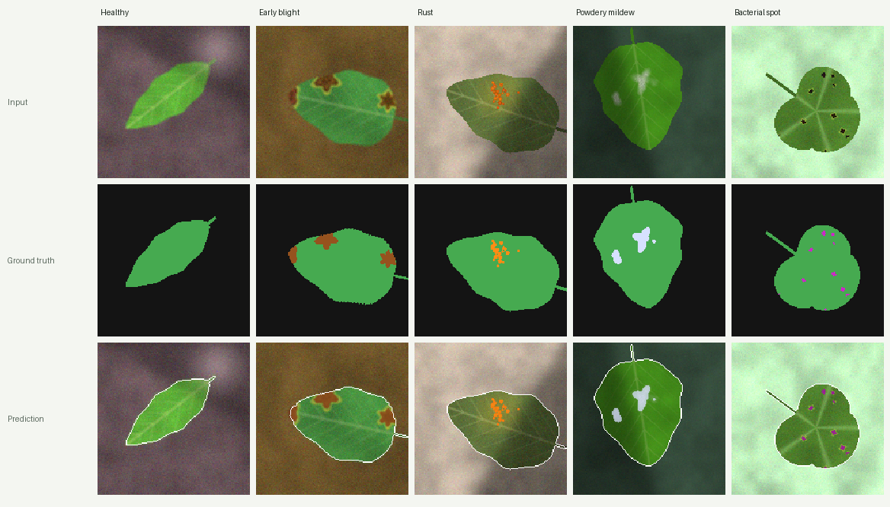

# 🌿 BlightSpot: Crop Disease Spotter

[](https://github.com/ved1j/blightspot-crop-disease-spotter/actions/workflows/ci.yml)

You snap a leaf on your phone, and BlightSpot labels **every pixel** as background, healthy leaf, or one of four diseases. It then tells you what the leaf most likely has, how much of it is affected, and what to do about it.

It covers the full pipeline end to end:

1. **Procedural data engine.** Synthetic leaves in 4 shapes, with 4 visually distinct diseases and photo-style degradations. Every image comes with a pixel-perfect label mask.
2. **Segmentation model.** A 6-class PyTorch U-Net, trained on an endless stream of fresh synthetic images. It uses CUDA or Apple MPS when available.
3. **Mobile-first PWA.** You can install it to your home screen. It has camera capture, a before/after slider, confidence maps, a per-disease breakdown, care tips, scan history, and a shareable report card.

> **Not a diagnostic tool.** The model has only ever seen procedurally generated leaves. It's an educational/portfolio project. Confirm any real diagnosis with a local extension service or plant pathologist.



## Results (held-out synthetic data)

<!-- metrics:start -->
| Metric | Score |
|---|---|
| Mean IoU over the 4 disease classes | **93.8%** |
| Image-level diagnosis accuracy | **99.2%** |
| Pixel accuracy | 99.7% |

<details>
<summary>Per-class IoU and diagnosis confusion matrix</summary>

| Class | IoU |
|---|---|
| Background | 99.8% |
| Healthy leaf | 99.0% |
| Early blight | 96.9% |
| Rust | 94.6% |
| Powdery mildew | 91.3% |
| Bacterial spot | 92.6% |

| true ↓ / predicted → | healthy | early blight | rust | powdery mildew | bacterial spot |
|---|---|---|---|---|---|
| **healthy** | 53 | 0 | 0 | 0 | 0 |
| **early blight** | 0 | 65 | 0 | 0 | 0 |
| **rust** | 0 | 0 | 41 | 0 | 1 |
| **powdery mildew** | 0 | 0 | 0 | 50 | 0 |
| **bacterial spot** | 0 | 0 | 1 | 0 | 45 |

</details>

Evaluated on 256 held-out images, after 3000 steps × 24 images (~14 min on mps).
<!-- metrics:end -->

`GET /metrics` serves these numbers, and you can see them in the app under **Model**. Expect real photos to score far lower. See [limitations](#limitations).

## What's inside

```
 data.py ─────────► training.py ─────────► weights/leaf_unet.pt + metrics.json
 procedural leaves    U-Net · CE + Dice          │
 + label masks        best-checkpoint by mIoU    ▼
                                     inference.py (TTA, report, overlays)
                                                 │
 frontend/ (PWA) ◄──── JSON + PNGs ──── main.py (FastAPI)
```

### Synthetic data (`backend/app/data.py`)

| | |
|---|---|
| **Leaf shapes** | ovate · lanceolate · cordate (heart-shaped) · palmately lobed. Some have serrated margins. Each has a petiole and either pinnate or palmate venation. |
| **Early blight** | brown lesions with concentric "target" rings and a yellow chlorotic halo |
| **Rust** | clusters of tiny raised orange pustules over faint yellowing |
| **Powdery mildew** | irregular, speckled whitish patches with soft edges |
| **Bacterial spot** | many small, dark, angular spots, some with thin halos |
| **Photo realism** | 6 background textures, out-of-focus leaves behind the subject, cast shadows, specular glare, blur, exposure and white-balance shifts, sensor noise |

About 20% of leaves are healthy and about 10% of diseased leaves carry two diseases. Halos and yellowing are drawn but deliberately labelled *leaf*, so the model has to learn the actual lesion boundary rather than "anything off-colour".

### Model & training (`model.py`, `training.py`)

- `LeafUNet` is a 4-level U-Net with skip connections, BatchNorm and bottleneck dropout. It has ~1.1M parameters and takes 160×160 input.
- The loss is class-weighted cross-entropy plus soft Dice averaged over the four disease classes. Lesions are a few % of pixels, so plain CE would ignore them.
- AdamW with a one-cycle LR schedule. A `DataLoader` with worker processes generates batches on the fly, so there's no dataset on disk and no overfitting to a fixed set.
- It's validated periodically and the best checkpoint by mean disease IoU is kept. The final evaluation runs on 256 held-out images and is written to `metrics.json`. It includes a per-class IoU table and an image-level diagnosis confusion matrix.

### Inference (`inference.py`)

- **Test-time augmentation.** Softmax is averaged over identity, horizontal and vertical flips, and a 90° rotation.
- **Report.** The primary diagnosis is the disease covering the most leaf area (≥ 0.5%). Severity is `healthy < 0.5% ≤ mild < 5% ≤ moderate < 15% ≤ severe`. You also get lesion counts per disease (connected components), per-disease confidence, and textbook care tips.
- **Guardrails.** It warns when little leaf is in frame or when model confidence is low, which usually means the photo looks unlike the training data.
- **Visuals.** A colour-coded overlay, a raw mask, and a viridis confidence map.

### Web app (`frontend/`)

A single HTML file plus a manifest and service worker, with no build step:

- 📷 camera capture (`capture="environment"`), gallery picker, drag-and-drop and paste
- client-side downscaling and EXIF orientation fix for big phone photos (HEIC on iOS works too)
- ↔️ before/after slider, plus Mask, Confidence and Ground-truth views
- per-disease breakdown and an "About this disease" card with care tips
- 🕑 recent-scan history stored on the device
- 📤 **Share report**: renders a PNG report card and opens the native share sheet (or downloads it)
- installable PWA with an offline app shell, dark mode, safe-area insets and reduced-motion support
- deep links: `/?sample=rust` opens straight to a rust example

## Run it

```bash
cd backend
python3 -m venv .venv && source .venv/bin/activate
pip install -r requirements.txt
uvicorn app.main:app --host 0.0.0.0 --port 8000
```

Open http://localhost:8000. On your phone, join the same Wi-Fi and open `http://<your-computer-ip>:8000`. Trained weights are committed. If they're missing, the API trains briefly on startup.

> Camera capture and "Install app" need a secure context. Both work on `localhost`. To test on a phone over the LAN, put the server behind HTTPS (e.g. `ngrok http 8000` or `cloudflared tunnel`). Picking from the gallery works over plain HTTP.

**Docker**

```bash
docker build -t blightspot .
docker run -p 8000:8000 blightspot
```

**Retrain**

```bash
cd backend
python train.py                # 3000 steps; ~12 min on an Apple M-series GPU
python train.py --steps 500    # quick run
python ../scripts/make_gallery.py   # refresh docs/gallery.png
```

**Tests**

```bash
cd backend && pytest -q
```

CI (GitHub Actions) runs the tests and a smoke-training pass. It also builds the Docker image and boots it.

## API

| Method | Path | Description |
|---|---|---|
| `POST` | `/analyze?tta=true` | multipart upload (`file`), returns the diagnosis report + base64 PNGs |
| `GET` | `/sample?disease=rust&seed=1` | generates and analyses a synthetic leaf (`random`, `healthy`, or any disease id), and includes the ground truth |
| `GET` | `/classes` | class legend (ids, colours) and disease info |
| `GET` | `/metrics` | held-out evaluation of the shipped weights |
| `GET` | `/health` | liveness |
| `GET` | `/docs` | interactive OpenAPI docs |

<details>
<summary>Example <code>/analyze</code> response</summary>

```json
{
  "diagnosis": "early_blight",
  "diagnosis_info": { "name": "Early blight", "cause": "Fungus (Alternaria spp.)", "symptoms": "…", "tips": ["…"] },
  "severity": "moderate",
  "affected_pct": 7.42,
  "lesion_count": 4,
  "diseases": [
    { "id": "early_blight", "name": "Early blight", "pixels": 512, "affected_pct": 7.42, "lesion_count": 4, "confidence": 0.97 }
  ],
  "confidence": 0.98,
  "warnings": [],
  "images": { "original": "<b64 png>", "overlay": "<b64 png>", "mask": "<b64 png>", "confidence": "<b64 png>" },
  "inference_ms": 85,
  "tta": true,
  "disclaimer": "Demo only: …"
}
```
</details>

## Limitations

- **Domain gap.** Real leaves have lighting, texture, scale and symptom variety that a procedural generator doesn't capture. The natural next step is fine-tuning on real annotated data (e.g. PlantVillage for classification, PlantSeg / PlantDoc for segmentation), using this synthetic pre-training as a warm start.
- It only knows 4 diseases. Anything else (nutrient deficiency, insect damage, sunscald) will be forced into one of those classes or into "healthy".
- It assumes one main leaf, roughly centred. Images are centre-cropped to a square.
- The care tips are general textbook information, not a treatment plan.

## License

MIT
